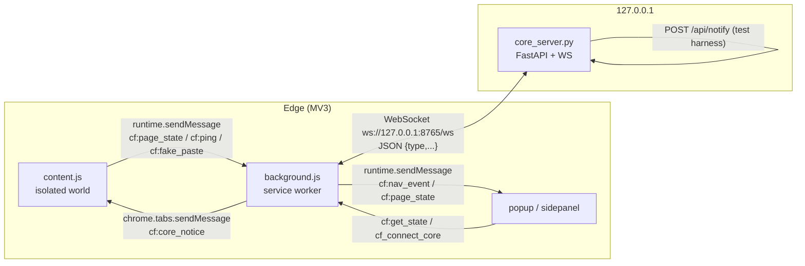

# ChatGPT Adapter 能力审计报告（CF-AUDIT-001）

- 审计对象：`D:\CortexFlow\contextflow-research\experiments\edge-extension-probe`（MV3 扩展原型）及配套本地服务
- 审计日期：2026-11-05
- 审计方式：源码逐行审阅 + 本次实际复现测试（不采信历史报告结论）
- 复现证据：`_artifacts/audit-repro-evidence.json`、`_artifacts/bridge-test-results.json`
- 审计约束：未向真实 ChatGPT 发送任何消息；未读取/保存登录凭据；未调用 ChatGPT 内部 API

---

## 1. Executive Summary

当前 Edge 扩展是研究探针，不是可用的 ChatGPT 适配器。已完成：MV3 加载、导航事件采集、与本地 Python Core 的 WebSocket 双向通信（含重连、Core 侧离线队列与重放）、"假剪贴板"注入原语（合成 paste 事件）。这些在本地 mock 页与协议测试中全部复现通过（19/19 + 13/13）。

但它不具备 Agent ↔ ChatGPT 完整闭环：content script 的会话/消息/生成状态解析只针对 mock 页 DOM（`.message`、`data-app-state`），真实 chatgpt.com 上实测 `messages.total=0`、`appState=null`；无发送触发代码；无请求 ID/响应匹配/超时；`session_ref` 路由字段不匹配，实测投到活动标签页而非目标会话。

最大阻塞点：缺少真实 ChatGPT 页面适配层（读取侧），其次是发送触发与请求-响应关联。

是否值得复用：值得。通信层与安全边界干净可复用；缺口集中在 `content.js` 的 DOM 适配与少量协议字段，可增量补齐。

---

## 2. Repository Map

```text
contextflow-research/
├── experiments/
│   ├── edge-extension-probe/          # 被审计的 MV3 扩展
│   │   ├── manifest.json              # MV3 配置（权限/host/内容脚本/侧边栏）
│   │   ├── background.js              # Service Worker：导航事件、页面状态缓存、Core WS 桥、命令路由
│   │   ├── content.js                 # 隔离世界内容脚本：页面分类、会话引用、消息统计、假剪贴板、通知条
│   │   ├── popup.html / popup.js      # 工具栏弹窗：Core 状态、页面状态、隔离实验统计
│   │   ├── sidepanel.html / sidepanel.js  # 侧边栏：四态"用户确认式交接"原型
│   │   └── README.md
│   ├── local-core-bridge/             # 本地 Python Core（研究版）
│   │   ├── core_server.py             # FastAPI + WebSocket：/ws、/events、/api/notify、/health
│   │   ├── bridge_test.py             # 协议测试（13 项）
│   │   └── README.md
│   ├── mock-chat-page/                # 本地模拟聊天页（两会话、SPA、流式）
│   │   ├── index.html / app.js / styles.css / serve.py
│   │   └── prosemirror-like.html      # 模拟 ProseMirror paste 契约的测试页
│   ├── playwright-probe/              # 自动化测试与审计脚本
│   │   ├── audit_repro.py             # 本次审计复现（19 项）
│   │   ├── playwright_probe.py        # 扩展端到端（历史）
│   │   ├── fake_clipboard_test.py     # 假剪贴板跨世界验证
│   │   ├── handoff_test.py            # 四态交接验证
│   │   └── ...
│   ├── electron-probe/                # Electron 双栏容器实验（与本审计无直接关系）
│   └── ...
├── reports/                           # 历史报告（本审计不直接采信其结论）
├── references/                        # 官方文档索引
└── _artifacts/                        # 证据：JSON 结果、日志、截图
```

**运行方式**

| 组件 | 启动方式 | 依赖 |
|---|---|---|
| Edge 扩展 | `edge://extensions` → 开发人员模式 → 加载解压缩的扩展 → 选 `experiments/edge-extension-probe` | Edge 116+（实测 156） |
| 本地 Core | `python core_server.py --port 8765` | Python 3.10、fastapi、uvicorn |
| 模拟聊天页 | `python serve.py --port 8787` | Python 标准库 |
| 自动化测试 | `python audit_repro.py` / `bridge_test.py` | Playwright 1.64.1 + 本机 Edge（`channel="msedge"`） |

**调试入口**：popup（工具栏图标）、side panel（`chrome.sidePanel`）、Service Worker 测试钩子 `globalThis.__cf`（`background.js:269-283`）、side panel 测试钩子 `window.__cfHandoff`（`sidepanel.js:118-123`）。

---

## 3. Capability Matrix

> 状态定义：VERIFIED = 本次复现通过；IMPLEMENTED_UNVERIFIED = 代码存在但本次未复现；PARTIAL = 部分实现或仅对 mock 页有效；DESIGN_ONLY = 仅设计/注释；NOT_IMPLEMENTED = 无实现。

### 3.1 ChatGPT 页面识别

| 能力 | 状态 | 源码位置 | 验证证据 | 限制 |
|---|---|---|---|---|
| 识别当前 ChatGPT Session | PARTIAL | `content.js:92-101`（URL 正则） | A9：真实 chatgpt.com 上 `kind=chatgpt`、`session.kind=none`（公开挑战页）；mock 页 A2 通过 | 仅 URL 正则；未使用 DOM 会话 id；真实登录态未通过扩展验证 |
| 识别 Project 内 Session | PARTIAL | `content.js:96-99` | 未在扩展内验证；URL 形态仅历史人工观察 | 正则把 `g-p-<id>-<slug>` 整体当 project；未验证 |
| 监听 SPA 导航 | VERIFIED（mock） | `background.js:143-146`；`content.js:186-199` | A3：pushState 产生 `onHistoryStateUpdated`，content 跟随到 session-b | 真实 ChatGPT SPA 未通过扩展验证 |
| 区分不同标签页 | PARTIAL | `background.js:164`（按 tabId 存状态） | A2/A5 单标签通过；A6 双标签暴露路由 bug | 无 tab↔session 绑定；路由字段不匹配 |
| 读取当前会话消息 | NOT_IMPLEMENTED（真实页） | `content.js:115`（`.message`） | A9：真实页 `messages.total=0`；mock 页 A4 通过 | 选择器只匹配 mock 页 |
| 区分 User/Assistant | PARTIAL | `content.js:118`（`data-role`） | A4：mock 页 user=2/assistant=2 | 真实页 `data-conversation-role` 未使用 |
| 提取消息文本 | NOT_IMPLEMENTED | — | 代码中无文本提取逻辑 | 只统计数量/最后 id |
| 获取消息 ID | PARTIAL | `content.js:137`（`data-message-id`） | A4：mock 页 lastId 正确 | 真实页 `data-chatgpt-selection-message-id` 未使用 |
| 判断正在生成 | PARTIAL | `content.js:124,133`（`data-app-state`） | A4：mock 页 generating 状态 | 真实页 `data-talvt-turn-state` 未使用 |
| 判断回复完成 | PARTIAL | 同上 | A4：mock 页 `lastStatus=complete` | 同上 |
| 处理刷新/切换/新建 | PARTIAL | `content.js:258-259`（重新注入） | A3 切换通过；刷新未单独复现 | 真实页未验证 |

### 3.2 消息输入与发送

| 能力 | 状态 | 源码位置 | 验证证据 | 限制 |
|---|---|---|---|---|
| 定位输入框 | PARTIAL | `content.js:211`（`.ProseMirror[contenteditable=true]` / `[contenteditable=true]`） | A8：本地 ProseMirror-like 页通过 | 真实 ChatGPT 未通过扩展验证 |
| 写入文本 | PARTIAL | `content.js:208-231`（合成 paste） | A8：文本成功插入；历史会话中 bsk evaluate 在真实页验证过同一机制 | 依赖编辑器接受 `isTrusted=false` 事件 |
| 触发正常输入行为 | PARTIAL | 同上 | A8：`defaultPrevented=true`，页面 paste 处理器执行 | 非受信任输入；未来前端可能拒绝 |
| 触发发送 | NOT_IMPLEMENTED | — | 代码中无点击发送/Enter 派发 | — |
| 判断发送成功 | NOT_IMPLEMENTED | — | — | — |
| 输入框不可用处理 | PARTIAL | `content.js:212` | 返回 `{ok:false,error}` | 无重试/降级 |
| 防止重复发送 | NOT_IMPLEMENTED | — | — | — |
| 发送前用户确认 | NOT_IMPLEMENTED | — | sidepanel 只有"复制汇报"，无发送 | — |

**五种能力分层结论**：① 仅修改 DOM —— 已实现（合成 paste）；② 正确输入编辑器 —— 本地验证通过，真实页仅历史人工验证；③ 触发发送 —— **未实现**；④ 确认进入会话 —— **未实现**；⑤ 关联后续回复 —— **未实现**。

### 3.3 双向通信

| 能力 | 状态 | 源码位置 | 验证证据 | 限制 |
|---|---|---|---|---|
| WebSocket 实现 | VERIFIED | `background.js:56-89`；`core_server.py:150-193` | A5/A7；bridge_test 13/13 | — |
| 谁建立连接 | VERIFIED | `background.js:266`（SW 启动即连）、`246-252`（alarm 保活） | A5 | — |
| 消息格式 | VERIFIED | JSON `{type, ...}` | 见第 5 节 | 无 schema 校验 |
| 双向主动发送 | VERIFIED | `sendToCore`（`background.js:98-103`）、Core `broadcast`（`core_server.py:133-147`） | A5、bridge_test D-01/D-02 | — |
| 请求 ID | NOT_IMPLEMENTED | — | — | 无 `request_id` 字段 |
| 请求/响应匹配 | NOT_IMPLEMENTED | — | 只有 `welcome`/`pong`，无关联 | — |
| 断线重连 | VERIFIED | `background.js:91-96`（指数退避） | A7：Core 重启后自动重连（attempts=3） | 无上限/无抖动 |
| 消息队列 | PARTIAL | Core `pending`（`core_server.py:50,127-130,169-173`）；扩展无出站队列 | bridge_test D-03c/d | 扩展离线时 `sendToCore` 直接返回 false，消息丢失 |
| 离线消息保存 | PARTIAL（仅 Core 侧） | 同上 | D-03c | 扩展侧不保存 |
| 重连后补发 | VERIFIED（Core→扩展） | `core_server.py:169-173` | D-03d | 扩展→Core 无补发 |
| 重复投递 | 存在风险 | 无去重 | D-03b：重复消息被接受 | 可能重复 |
| 超时机制 | NOT_IMPLEMENTED | — | — | — |
| 错误响应 | PARTIAL | HTTP 400/401/403；WS 仅日志 | D-03e/f/g/h | WS 无错误回包 |
| SW 休眠后状态恢复 | IMPLEMENTED_UNVERIFIED | `background.js:36,165,249`（storage.session） | 本次未复现（历史 B-09 曾验证） | 需复测 |
| Core 重启后恢复 | VERIFIED | `background.js:81-96` | A7 | — |

### 3.4 安全边界

| 能力 | 状态 | 源码位置 | 验证证据 | 限制 |
|---|---|---|---|---|
| 本地服务监听地址 | VERIFIED | `core_server.py:199`（默认 127.0.0.1） | 代码审阅 | — |
| Token 鉴权 | VERIFIED | `core_server.py:70-73,159-163`；`background.js:16,62` | D-03e/h | Token 硬编码在源码（实验用） |
| Origin 校验 | VERIFIED | `core_server.py:62-67,104-108,154-158` | D-03f/g | 允许任意 `chrome-extension://` |
| 扩展权限 | VERIFIED | `manifest.json:7-22` | A1 manifest | 含 `clipboardWrite/Read`、`scripting`、`sidePanel` |
| 页面/扩展隔离 | VERIFIED（机制） | content script 隔离世界；MAIN world 走 `chrome.scripting`（`background.js:193-217`） | A8/A9 | — |
| 不可信网页触发本地操作 | 低风险 | 页面无法直接向 Core 发消息；content 只上报结构状态 | 代码审阅 | 若未来增加页面→Core 通道需重新评估 |
| 任意命令执行入口 | 无 | 无 eval/exec/子进程调用 | 代码审阅 | — |
| 读取/保存登录凭据 | 无 | 无 cookie/token 读取 | 代码审阅 | — |
| 调用 ChatGPT 内部 API | 无 | 仅 DOM + 扩展 API | 代码审阅 | — |
| 需要用户授权的自动化 | 发送未实现；注入为程序化 DOM 操作 | `content.js:208-231` | A8 | 设计上应加用户确认 |

---

## 4. Communication Architecture

**已实现链路**（本次复现）：



**计划中但未实现**（不要当作现状）：

```text
External Agent ──request_id──▶ Core ──command──▶ Extension ──send──▶ ChatGPT
External Agent ◀──response──── Core ◀──reply──── Extension ◀──read─── ChatGPT
```

当前 Core→扩展只有 `worker_completed`/`notify`/`ping` 三种命令；扩展→Core 只有 `hello`/`nav_event`/`page_state`/`pong` 四种事件。没有通用命令通道、没有请求 ID、没有响应关联。

---

## 5. Message Protocol

当前实际使用的消息均为 JSON 对象，以 `type` 字段区分。**Token 已脱敏**。

### 5.1 扩展 → Core

```json
{"type":"hello","source":"edge_extension","version":"0.1.0"}
{"type":"nav_event","source":"edge_extension","kind":"webNavigation.onHistoryStateUpdated","tabId":123,"url":"https://chatgpt.com/c/<id>"}
{"type":"page_state","source":"edge_extension","tabId":123,"kind":"chatgpt","url":"...","session":{"kind":"chat_path","value":"<id>"},"messages":{"total":0,...},"isolation":{...}}
{"type":"pong","at":"2026-11-05T00:00:00.000Z"}
```

### 5.2 Core → 扩展

```json
{"type":"welcome","client_id":"client-<ts>","pending":0}
{"type":"worker_completed","at":"...","task_id":"task-001","summary":"...","session_ref":"session-b"}
{"type":"pong","at":"..."}
```

### 5.3 HTTP 接口（Core）

| 方法 | 路径 | 说明 |
|---|---|---|
| GET | `/health` | 健康检查、在线客户端、pending 数 |
| GET | `/api/events` | 最近接收事件（内存，最多 500） |
| POST | `/events` | 扩展 HTTP 兜底上报（Origin + Token） |
| POST | `/api/notify` | 测试/Worker 完成 → 推送或入队 |

### 5.4 缺失的协议要素

- **无 `request_id` / `correlation_id`**：无法把回复关联到原始请求。
- **无 `message_id`**：无法去重（实测重复消息被接受）。
- **无超时/重试语义**：扩展离线时出站消息直接丢弃。
- **无错误回包**：WS 非法消息只写日志，不回错误。
- **无版本协商**：`hello` 带 version 但 Core 不校验。

---

## 6. ChatGPT DOM Adapter

当前 `content.js` 使用的选择器/属性：

| 用途 | 选择器/属性 | 源码位置 | 验证情况 | 风险 |
|---|---|---|---|---|
| 页面分类 | `location.hostname` | `content.js:83-88` | A9 真实 chatgpt.com 通过 | 低 |
| 会话引用（URL） | `/c/<id>`、`/g/<project>/c/<id>`、`/g/<project>/project` | `content.js:92-101` | mock 页通过；真实页仅公开挑战页（session=none） | URL 结构非官方契约 |
| 消息容器 | `.message` | `content.js:115` | **仅 mock 页** | 真实 ChatGPT 不使用该类名 |
| 角色 | `data-role` | `content.js:118` | 仅 mock 页 | 真实页为 `data-conversation-role` |
| 消息 id | `data-message-id` | `content.js:137` | 仅 mock 页 | 真实页为 `data-chatgpt-selection-message-id` |
| 生成状态 | `body[data-app-state]` | `content.js:124,133` | 仅 mock 页 | 真实页为 `[data-talvt-turn-state]` |
| 输入框 | `.ProseMirror[contenteditable=true]` | `content.js:211` | 本地 ProseMirror-like 页通过 | 真实页选择器匹配但未通过扩展验证 |
| 主区域 | `main` / `#conversation` | `content.js:130` | mock 页通过 | 真实页 `hasMainRegion=false`（挑战页） |
| 导航信号 | `popstate`/`hashchange`/标题轮询/MutationObserver | `content.js:186-199` | A3 通过 | 真实页未验证 |

**关键事实**：真实 ChatGPT（2026-11 版）的 DOM 契约（`data-conversation-role`、`data-talvt-turn-state`、`data-chatgpt-selection-message-id`、`data-chatgpt-selection-conversation-id`）**已经由历史人工探测确认存在**，但**当前扩展代码完全没有使用它们**。这是读取侧缺口的直接原因。

---

## 7. End-to-End Interaction Assessment

理想流程与当前实现逐步对照：

| 步骤 | 当前状态 | 说明 |
|---|---|---|
| 1. External Agent 指定 ChatGPT Session | PARTIAL / 有 bug | Core 可接收 `session_ref`，但扩展 `handleCoreCommand` 查找的是 `ps.session_ref`，而 content 上报字段是 `session`（`background.js:111-115` vs `content.js:131`）→ 永远不匹配，回退到活动标签页。A6 实测：请求 session-b，通知投到 session-a |
| 2. Extension 向 ChatGPT 发送消息 | NOT_IMPLEMENTED | 只有 `cf:fake_paste` 注入文本，无发送触发 |
| 3. ChatGPT 生成回复 | 外部行为 | — |
| 4. Extension 读取完整回复 | NOT_IMPLEMENTED（真实页） | 无真实页 DOM 适配；无文本提取 |
| 5. Extension 判断回复完成 | NOT_IMPLEMENTED（真实页） | 未使用 `data-talvt-turn-state` |
| 6. 回复返回原始请求方 | NOT_IMPLEMENTED | 无请求 ID/响应关联 |
| 7. 连续多轮交互 | NOT_IMPLEMENTED | 无会话状态机 |
| 8. 人工步骤 | 存在 | 发送需用户手动；回复需用户手动复制（sidepanel 交接原型） |

**第一个实际阻塞点**：**扩展没有真实 ChatGPT 页面适配层**。在真实 chatgpt.com 上，content script 上报 `messages.total=0`、`appState=null`（A9 实测），因此"读取当前会话消息/判断生成完成"从第一步就不成立。即使补上发送，也无法把回复读回来。

**第二个阻塞点**：无发送触发与请求-响应关联（写入侧/闭环侧）。

**第三个问题**：`session_ref` 路由字段不匹配（A6 实测），多标签页场景会投错会话。

---

## 8. Reproduction Results

**环境**：Windows 11 Build 26200；Microsoft Edge 156.0.4314.58；Python 3.10.11；Playwright 1.64.1；FastAPI 0.139.2 / uvicorn 0.51.0；扩展以未打包方式由 Playwright `--load-extension` 加载（无头 Edge）。

**测试命令**：

```powershell
# 1) 启动模拟页
cd experiments\mock-chat-page; python serve.py --port 8787

# 2) 审计复现（Core 由脚本自行启停）
cd experiments\playwright-probe; python audit_repro.py

# 3) Core 协议测试
cd experiments\local-core-bridge
python core_server.py --port 8765   # 另一个终端
python bridge_test.py --port 8765
```

| 编号 | 测试 | 预期 | 实际 | 结果 |
|---|---|---|---|---|
| A1-01 | 扩展加载 / SW 存在 | MV3、SW 启动 | id=`ecdmenhoofjafenfmeflnkfomcffoohl` | PASS |
| A2-01/02/03 | mock 页识别、会话引用、消息统计 | kind=mock-chat、session-a、2 条 | 一致 | PASS |
| A3-01/02 | SPA pushState 检测 | onHistoryStateUpdated + 跟随 | 1 条事件、session-b | PASS |
| A4-01/02/03 | mock 页消息读取 | 4 条、complete、user/assistant 各 2 | 一致 | PASS |
| A5-01~04 | Core↔扩展双向 | 连接、Core 可见、推送、DOM 通知 | 全部一致 | PASS |
| A6-01 | session_ref 路由 | 应投到 session-b | **实际投到活动标签页 session-a** | PASS（验证了 bug 存在） |
| A7-01/02 | 断线重连 | 断开感知 + 自动重连 | disconnected → connected（attempts=3） | PASS |
| A8-01 | 假剪贴板注入 | 文本进入 ProseMirror-like 编辑器 | `audit fake paste` 插入 | PASS |
| A9-01/02 | 真实 chatgpt.com 公开页 | content script 运行、kind=chatgpt | kind=chatgpt、session=none、messages=0 | PASS |
| D-01~D-03 | Core 协议（13 项） | 双向/队列/鉴权/Origin | 13/13 | PASS |

**汇总**：`audit_repro.py` **19/19 通过**；`bridge_test.py` **13/13 通过**。证据文件：`_artifacts/audit-repro-evidence.json`、`_artifacts/bridge-test-results.json`、`_artifacts/core-server.log`、`_artifacts/core-events.jsonl`。

**本次未执行**：
- 真实登录态 ChatGPT 页面上的扩展读取/注入（需用户授权与登录态；本次仅在公开挑战页验证 content script 可运行）。
- 向真实 ChatGPT 发送消息（按任务要求，未获明确授权，不执行）。
- Service Worker 自然休眠/强制终止复测（历史曾验证，本次未复现，标记 IMPLEMENTED_UNVERIFIED）。

---

## 9. Known Issues and Risks

### 事实（本次已验证）

1. **真实页读取缺失**：content script 只识别 mock 页 DOM；真实 chatgpt.com 上 `messages.total=0`、`appState=null`（A9 + `content.js:115,124`）。
2. **无发送能力**：代码中无点击发送/Enter 派发（全仓库检索无相关实现）。
3. **session_ref 路由 bug**：`background.js:111-115` 查 `ps.session_ref`，content 上报 `session`（`content.js:131`）→ 永不匹配，回退活动标签页（A6 实测）。
4. **无请求 ID/响应关联/超时/去重**：协议层缺失（第 5.4 节）。
5. **扩展出站消息无队列**：Core 离线时 `sendToCore` 返回 false，消息丢失（`background.js:98-103`）。
6. **Token 硬编码**：`background.js:16`、`core_server.py:41` 为实验用固定 token，不可用于生产。
7. **Origin 允许任意扩展**：`core_server.py:62-67` 接受任意 `chrome-extension://`，生产需绑定具体扩展 id。
8. **假剪贴板依赖不可信事件**：`isTrusted=false` 的 paste 事件当前被接受（A8），未来可能被拒绝。

### 合理推测（基于代码/机制，未直接验证）

- 真实 ChatGPT 的 DOM 属性（`data-conversation-role`、`data-talvt-turn-state`、`data-chatgpt-selection-message-id`、`data-chatgpt-selection-conversation-id`）**很可能**可直接用于补齐读取侧（历史人工探测已确认存在），但需在扩展内实测。
- `chrome.scripting.executeScript({world:"MAIN"})` 可绕过页面 CSP 读取页面状态（历史 mock 页验证），真实页未验证。
- SW 休眠后 `storage.session` 可恢复状态（历史验证），但本次未复测。

### 待验证假设

- 真实 ChatGPT 页面上 content script 能否稳定注入并读取（受 CSP/Cloudflare/页面结构影响）。
- 真实页上"合成 paste"能否被接受（历史 bsk evaluate 验证过，但非扩展隔离世界）。
- 多标签页/多 Project 下会话绑定是否可靠。

---

## 10. Recommended Next Experiment

### CF-AUDIT-NEXT-01：真实 ChatGPT 页面只读适配层最小验证

**为什么优先**：这是唯一能同时验证"读取侧可行性"和"DOM 契约稳定性"的最小实验；不发送消息、风险最低；若失败，才需要考虑 Playwright。

**需要修改的文件**（只读适配，不发送）：
- `experiments/edge-extension-probe/content.js`：在 `readPageState()` 中增加真实 ChatGPT 分支：
  - 会话 id：`[data-chatgpt-selection-conversation-id]` / `[data-above-composer-conversation-id]`
  - 角色：`h4[data-conversation-role]`
  - 回合状态：`[data-talvt-turn-state]`（`in_progress` / `complete`）
  - 消息 id：`[data-chatgpt-selection-message-id]`
  - 消息数量：按回合容器统计（不提取正文）
- `experiments/edge-extension-probe/background.js`：修正路由字段（`ps.session_ref` → 使用 `session.value` 或统一字段名）。
- 可选：`popup.js` 展示真实页字段，便于人工核对。

**预期投入**：0.5–1 人日（含一次真实登录态人工验证）。

**成功判据**（全部满足）：
1. 在真实登录态 ChatGPT 会话中，扩展上报的会话 id 与 URL 中的 `/c/<id>` 一致；
2. 消息数量与页面可见回合数一致（允许懒加载差异，需记录）；
3. 生成中 `in_progress`、完成后 `complete` 可被扩展正确上报；
4. 刷新/切换会话后仍能正确上报；
5. 全程不发送任何消息、不读取正文。

**失败后的决策**：若真实页上 content script 无法稳定注入，或上述 DOM 属性在刷新/重新生成/多会话下不稳定，则说明"扩展读取侧"的维护成本过高，应转向 **Playwright + 独立 profile** 方案（代价：登录态迁移、与用户操作冲突、反自动化风险），并把扩展降级为"界面/交接"角色。

---

## 附：本次审计未覆盖

- Electron 容器、Playwright 通用能力（历史实验，不在本次范围）。
- 官方 MCP/Tunnel 路径（历史文档核查，不在本次范围）。
- 生产级安全加固、消息持久化、多客户端并发。
