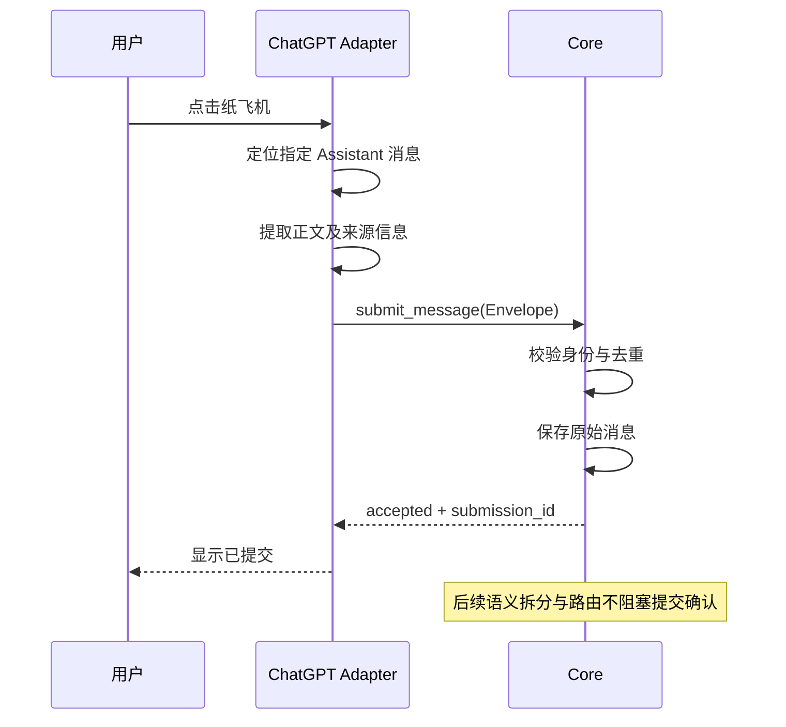
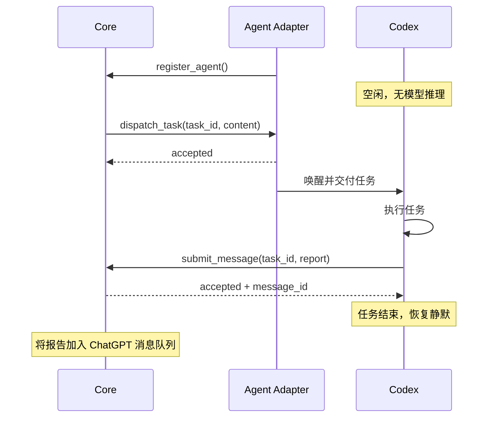

## 整体架构：双向消息流，统一由 Core 交接


下行： ChatGPT → Adapter → Core → Agent

上行： Agent → Core → ChatGPT Adapter → ChatGPT

## 权限模型：建议先定义三个级别

根据你的描述，我将权限理解为：

| 权限模式 | ChatGPT → Core             | Core → ChatGPT                     |
| -------- | -------------------------- | ---------------------------------- |
| 全部询问 | 用户点击纸飞机             | 每次投递前用户确认                 |
| 部分询问 | 用户点击纸飞机             | 满足预授权规则可自动投递，其余询问 |
| 完全权限 | ChatGPT 生成完成后自动采集 | 满足安全条件后自动投递             |

## 用一个完整案例说明

假设你让 ChatGPT 协调 Codex 修复 ContextFlow 的一个 Bug。

\1. ChatGPT 生成任务

“请 Codex 修复消息关联错误，并运行相关回归测试。”

在全部询问或部分询问模式下，你点击回复旁边的纸飞机图标。

\2. Adapter 打包，Core 接收

信封保留来源 Endpoint、原生消息 ID、回合信息、原始正文和规范化正文。

Core 分配 `message_id`，保存原始内容，识别任务目标为 Codex，并建立投递记录。

\3. Codex 执行并返回简短汇报

“已修复消息关联错误，新增 4 项回归测试，全部通过。未发现阻塞问题。”

Codex 将汇报提交给 Core，而不是直接操作 ChatGPT。

\4. Core 标识来源并入队

Core 将结果关联到原任务，形成一条待发送至 ChatGPT 的消息。

消息预览

来源：Codex · 任务 CF-CORE-002

状态：等待发送授权

内容：已修复消息关联错误……

\5. 权限检查与投递

如果需要人工确认，消息留在队列中；获得授权后，Core 调用 ChatGPT Adapter 将消息注入指定对话。

Adapter 报告实际发送结果，Core 更新投递状态。

最终 ChatGPT 看到的是一条带有明确来源和任务关联的 Codex 汇报，不需要知道它经过了什么浏览器、Bridge 或 WebSocket。

## 先明确 Adapter 的职责边界

我们现在已经有了 CF-CORE-001 的 Endpoint 机制，因此不需要重新设计会话发现、绑定与消息读取。

在此基础上，Adapter 需要增加的是消息提交能力。


## Adapter 应该向 Core 提供哪些能力？

我建议区分已有的基础能力与本阶段新增的能力。

| 能力                      | 用途                     | 状态   |
| ------------------------- | ------------------------ | ------ |
| `discover()`              | 发现 ChatGPT 会话        | 已实现 |
| `bind()` / `resolve()`    | 建立和恢复 Endpoint 身份 | 已实现 |
| `read()`                  | 获取规范化消息           | 已实现 |
| `submit_message()`        | 将指定消息提交 Core      | 待设计 |
| `get_submission_status()` | 查询提交是否被 Core 接收 | 可选   |



## Agent 需要哪些接口？

三个基础能力。

| 接口               | 方向         | 职责                       |
| ------------------ | ------------ | -------------------------- |
| `register_agent()` | Agent → Core | 注册当前 Agent 会话        |
| `get_tasks()`      | Agent ← Core | 获取分配给自己的待处理任务 |
| `submit_report()`  | Agent → Core | 向 Core 提交执行结果       |



## Core 的整体消息流

## Core 接收什么？

我建议 Core 只接收两类外部业务消息，内部统一保存为 Message。

| 来源                | 接收内容                     | 典型用途               |
| ------------------- | ---------------------------- | ---------------------- |
| ChatGPT Adapter     | Assistant 完整回复及来源信息 | 拆分任务、派发 Agent   |
| Agent Adapter / SDK | Agent 的简短汇报、问题或通知 | 关联任务、回传 ChatGPT |

每条消息至少保留：

- `message_id`：Core 内部唯一标识。
- `source_endpoint_id`：来源端点。
- `source_message_id`：外部系统原生消息 ID（如存在）。
- `content`：原始正文，不被 LLM 改写。
- `correlation_id`：关联的任务或上游消息。
- `metadata`：回合、触发方式、内容格式等信息。

另外，消息本身和提交行为要分开：`submission_id` 用于幂等接收，`message_id` 用于标识 Core 已保存的消息。

## Core 传递什么？

我建议区分两种输出。

### A. 发送给 Agent 的 Task

ChatGPT 可能一次性给出多个任务，因此 Core 需要将一条消息拆成若干可独立投递的 Task。

例如 ChatGPT 回复：

> 请 Codex 修复消息关联问题并运行测试。另外请另一个 Agent 检查相关文档。

Core 的 Parser 可以产生：

```
{
  "source_message_id": "cfmsg_001",
  "tasks": [
    {
      "target": "codex",
      "content": "修复消息关联问题并运行测试"
    },
    {
      "target": "docs_agent",
      "content": "检查相关文档"
    }
  ]
}
```

Core 随后检查两个目标是否存在、是否被授权，再分别建立投递记录。

LLM 不能自行创建 Agent，也不能因为理解了任务就绕过权限检查。

### B. 发送给 ChatGPT 的 Report

Agent 完成任务后提交：

```
{
  "task_id": "cftask_001",
  "status": "completed",
  "summary": "已修复消息关联问题，相关测试全部通过。"
}
```

Core 应该保留原始汇报，补充来源与任务标识，然后加入 ChatGPT 的待发送队列。

这里一般不需要再次调用 LLM。Agent 的汇报已经是结构化信息，Core 只需要做确定性封装。

## 传递过程中 Core 需要做什么？

我认为有六项必要工作。

| 环节 | Core 的职责                                |
| ---- | ------------------------------------------ |
| 接收 | 验证身份、检查消息格式、保证幂等           |
| 保存 | 保留原始消息及来源信息                     |
| 拆分 | 使用规则或 LLM 提取目标与消息片段          |
| 校验 | 验证目标 Agent、权限和任务关联             |
| 投递 | 调用目标 Adapter，记录投递状态             |
| 追踪 | 将 Agent 汇报关联到原 Task，并生成回传消息 |

其中最重要的是保存原文与拆分结果分离。

LLM 拆分错误时，我们可以重新解析原消息，而不需要重新从 ChatGPT 页面获取内容。