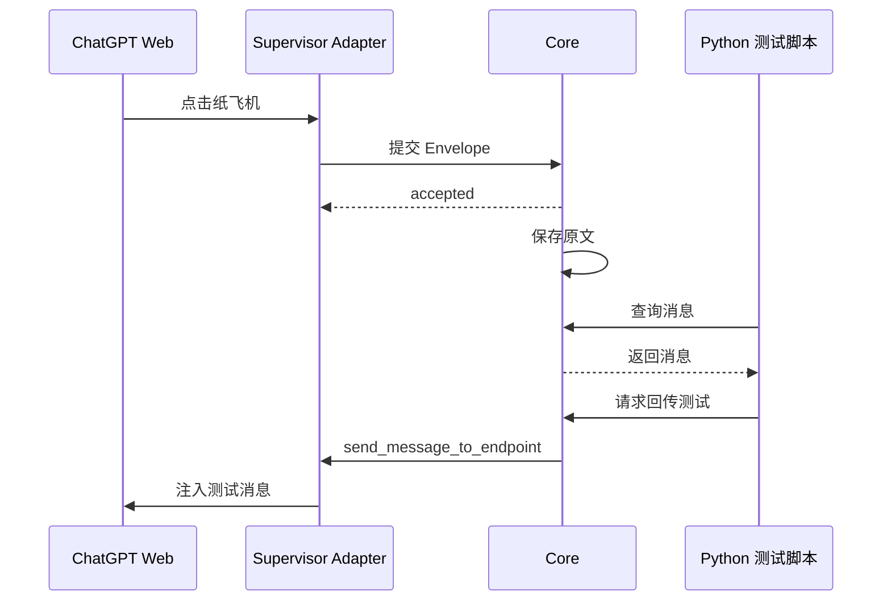
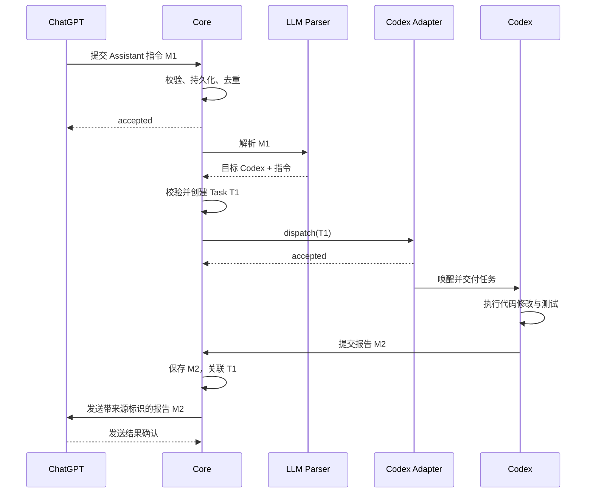

我们可以把接下来的开发分成三个阶段：

阶段 A：Core 消息接收与存储

让 Core 真正接收 Adapter 的 Envelope，保存原始消息，处理重复提交，并能通过简单脚本查看消息。

先不引入 LLM，也不连接 Agent。

阶段 B：LLM 语义拆分与目标提取

对已保存的 Assistant 消息进行解析，提取目标 Agent 和待发送的内容。

LLM 只负责结构化提取，不负责自主决策。解析结果可以先打印出来，由脚本检查。

阶段 C：Core 投递与回传

Core 根据解析结果调用目标 Agent Adapter；Agent 完成后主动汇报，Core 再通过现有 `send_message_to_endpoint` 将汇报发送给 ChatGPT。

这里才需要引入最小的投递状态管理。


## 一个完整的双向协作案例

假设 ChatGPT 指示 Codex 修改代码。



## 进一步精简 Core 的模块

模块 1：Message Store

接收 ChatGPT 与 Agent 消息，校验、去重、持久化，维护消息与 Task 的关联。

模块 2：Instruction Parser

从 ChatGPT 的完整回复中提取目标 Agent 和指令正文。默认一条指令对应一个 Agent，只有明确指定多个独立目标时才拆分。

模块 3：Dispatcher

验证目标、创建 Task、调用 Agent Adapter，记录投递结果；接收 Agent 汇报并调用 ChatGPT Adapter 回传。

这里的三个模块是逻辑边界。底层的 Endpoint Registry、Bridge 和数据库连接可以作为共享基础设施，不需要重新开发。

## 一个具体例子

ChatGPT 发送：

> 请 Codex 修复 Supervisor Adapter 的消息身份识别问题，运行测试，并向我汇报结果。如果需要其他 Agent 协助，可以自行协调。

Core 只需要提取：

```
{
  "target_agent": "codex",
  "instruction": "修复 Supervisor Adapter 的消息身份识别问题，运行测试，并向 Coordinator 汇报结果。"
}
```

然后生成 `task_id`，附加来源信息，交付 Codex。

Codex 最终提交：

```
{
  "task_id": "cftask_001",
  "type": "completed",
  "summary": "已修复消息身份识别问题，相关测试通过。"
}
```

Core 将它封装为：

> 【ContextFlow · Codex · Task cftask_001】
> 状态：completed
> 已修复消息身份识别问题，相关测试通过。

然后通过现有的 `send_message_to_endpoint` 送回对应的 ChatGPT 会话。

整个过程中，Core 不需要理解代码修改内容，也不需要判断是否应该继续下一项工作。

 CF-CORE-002-0：当前消息流转、基础设施与防护报告

  当前已实现的链路，可以把监管者网页中选定的一条 Assistant
  消息，经扩展和 Bridge 送到独立的 Mock 接收器；阶段 0
  的公共契约尚未接入正式的解析、任务创建和 Agent 投递流程。

  本报告依据当前仓库代码整理，提供可复制到网页端渲染的 Mermaid
  泳道图，并区分：

  - 已实现机制：当前有实际执行代码。
  - 已实现契约：当前有数据类型、校验或接口定义，但没有对应业务服务。
  - 尚未实现流程：属于后续 A/B/C/D/E 阶段。

---

  第一层：Supervisor Summary

  当前完成了什么

  1. 网页消息提交基础链路已经存在。
     人工点击指定 Assistant 回复的纸飞机，扩展提取正文、构造
     Supervisor Envelope v1，经 Bridge 转交 Python
     测试接收器，并把确认结果返回网页。
  2. Endpoint 基础设施已经存在。
     可以发现会话、绑定稳定 Endpoint
     ID、重新解析当前标签页位置，并读取渲染中的消息快照。
  3. 测试接收器已经具备格式校验、提交去重、冲突检测和可选 JSON
     文件保存。
     但它不是正式 Message Store，也不核验 Endpoint
     与原生会话之间的绑定一致性。
  4. 阶段 0 已提供后续模块共同使用的数据与接口契约。
     包括 Message、ParseResult、Task、Delivery、AgentReportEnvelope，
     以及结构、身份类型、状态组合、不可变快照和任务意图指纹校验。

  最重要的边界

  - 消息被接收，不等于任务被解析、派发或执行。
  - 字段合法，不等于 Agent 存在，也不等于指令语义完整。
  - Bridge 转发成功，不等于接收端已保存。
  - DOM 发送验证，不等于 ChatGPT 服务端持久保存或任务完成。
  - 阶段 0 的接口要求，不等于这些业务保障已经实现。

  本轮重新运行了契约测试：62 passed，132 subtests passed。没有修改仓
  库文件，也没有执行真实浏览器通信或新的端到端验收。

---

  第二层：Technical Details

  1. 先明确两种不同的“发送”

  理解当前系统时，需要区分：

  1.1 监管者消息提交给 Core

  提交的是一条选定的 Assistant 回复正文。

  这一步解决的是：

  ▎ 把这段内容及其来源信息交给 Python 接收端。

  它不要求正文已经包含可执行任务。例如，一段普通说明，只要 Envelope
  格式合法，也可以被当前 Mock 接收器接受。

  1.2 Core 将任务投递给 Agent

  这一步才需要：

  - 提取明确的目标 Agent。
  - 检查任务正文的结构。
  - 核验目标 Agent 是否存在、是否唯一。
  - 完成整批准入。
  - 创建 Task 和 Delivery。
  - 执行实际投递。

  这套正式业务流程尚未实现。

  所以，“原文里没有明确 Agent”不一定意味着消息不能提交给
  Core；它意味着未来 Parser 应返回
  unresolved，而不是猜测目标并创建任务。

---

  2. 泳道图一：当前已经实现的监管者消息提交路径

  2.1 图的适用前提

  以下描绘的是现有代码能够执行的路径，不是声称这些服务此刻正在运行。

  图中假定：

  - 监管者会话已有 Endpoint 绑定。
  - 扩展及 Bridge 页面已连接。
  - Python 测试接收器正在运行。
  - 测试接收器启用了 JSON 文件保存。

  这里的“监管者”是项目赋予某个 ChatGPT
  会话的业务角色。扩展代码本身并没有识别或认证 Supervisor
  身份；它对可见 Assistant 消息提供提交按钮。

  图中实线表示操作或请求，虚线表示结果返回，不使用虚线代表“未实现”。

  mermaid
  sequenceDiagram
      autonumber
      participant Chat as 监管者网页（人工点击）
      participant Content as content.js
      participant Background as background.js
      participant Relay as 扩展 relay
      participant Page as Bridge 页面 JS
      participant Bridge as Python Bridge
      participant Receiver as Python Mock 接收器
      participant File as JSON 测试文件

      Chat->>Content: 点击指定 Assistant 消息的纸飞机
      Content->>Content: 检查会话 ID、消息 ID、正文及生成状态
    
      opt 首次提交需要查询既有 Endpoint
          Content->>Background: cf:resolve_endpoint(session_id)
          Background->>Relay: cf:bridge_endpoint_lookup
          Relay->>Page: cf:endpoint_lookup
          Page->>Bridge: endpoint_lookup(request_id, session_id)
          Bridge->>Bridge: 只读查询 Endpoint Registry
          Bridge-->>Page: endpoint_lookup_result(found, endpoint_id)
          Page-->>Relay: 查询结果事件
          Relay-->>Background: 查询结果
          Background-->>Content: 已绑定 Endpoint 或错误
      end
    
      Note over Content,Bridge: 查询不会自动注册新
  Endpoint；未绑定时不能正常构造提交

      Content->>Content: 构造或复用 Supervisor Envelope v1
      Content->>Content: 更新本地提交记录及重试快照
      Content->>Background: cf:submit_envelope(envelope)
      Background->>Relay: cf:bridge_submit(envelope)
      Relay->>Page: cf:submit_envelope(request_id, envelope)
      Page->>Bridge: adapter_submission(request_id, envelope)
    
      Bridge->>Bridge: 基本请求检查，登记内存中的确认关联
    
      alt 有外部接收端可接收
          Bridge->>Receiver: 广播 submission(request_id, envelope,
  at)
          Receiver->>Receiver: 校验 Envelope，计算完整 Envelope 指纹
          Receiver->>Receiver: 按 submission_id 查询既有记录

          alt 首次合法提交
              Receiver->>File: 保存 Envelope、指纹及接收记录
              File-->>Receiver: 正常写入成功
              Receiver-->>Bridge: submission_ack(accepted,
  duplicate=false)
          else 同 ID、同完整 Envelope
              Receiver-->>Bridge: submission_ack(accepted,
  duplicate=true)
          else 格式不合法或同 ID 内容冲突
              Receiver-->>Bridge: submission_ack(rejected 或
  conflict, error)
          end
      else 无外部接收端
          Bridge->>Bridge: 生成 rejected / NO_RECEIVER
      end

      Bridge-->>Page: submission_ack，附回本次 request_id
      Page-->>Relay: cf:submit_result
      Relay-->>Background: 提交结果
      Background-->>Content: 提交结果
      Content->>Content: 更新本地状态及重试记录
      Content-->>Chat: 已送达、失败或结果不确定
    
      Note over Receiver,File: 当前路径在此结束；不会自动生成
  ParseResult、Task 或 Delivery

  2.2 图中各部分实际负责什么

  ┌───────────────┬──────────────────────────────────────────────┐
  │     部分      │                   实际职责                   │
  ├───────────────┼──────────────────────────────────────────────┤
  │ content.js    │ 读取选定消息、构造                           │
  │               │ Envelope、管理按钮状态和提交重试记录         │
  ├───────────────┼──────────────────────────────────────────────┤
  │ background.js │ 寻找可用 Bridge 页面，通过扩展消息转交请求   │
  ├───────────────┼──────────────────────────────────────────────┤
  │ 扩展 relay    │ 在 chrome.runtime 消息与页面 DOM             │
  │               │ 事件之间转发                                 │
  ├───────────────┼──────────────────────────────────────────────┤
  │ Bridge 页面   │ 建立浏览器侧 WebSocket，等待并关联提交结果   │
  │ JS            │                                              │
  ├───────────────┼──────────────────────────────────────────────┤
  │ Python Bridge │ 查询绑定、转发消息、关联接收端 ack           │
  ├───────────────┼──────────────────────────────────────────────┤
  │ Mock 接收器   │ 校验 Envelope、去重、检测冲突、保存测试记录  │
  ├───────────────┼──────────────────────────────────────────────┤
  │ JSON 文件     │ 保存 Mock 接收记录；不是正式 Core 数据库     │
  └───────────────┴──────────────────────────────────────────────┘

  扩展并不是直接建立 WebSocket 的一方。 WebSocket 由普通 Bridge
  页面中的 JavaScript 建立，relay 负责跨扩展与页面的边界转发。

  2.3 当前 Python Adapter 不等于这个接收器

  已有 WebSocketChatGPTAdapter 主要处理：

  - 发出请求。
  - 等待相同请求 id 的响应。
  - 超时、断线及后续重连。

  它目前没有：

  - Supervisor submission 订阅接口。
  - 正式消息持久化入口。
  - 自动发送 submission_ack 的业务处理器。

  因此，不能把“Python Adapter 已连接 Bridge”理解为“正式 Core
  已经接收并处理监管者消息”。

  当前处理 submission 并返回 ack 的，是实验脚本调用的
  MockCoreReceiver。

  源码定位：

  - contextflow-research/experiments/adapter-mock/mock_core.py:65
  - contextflow-research/contextflow_core/adapter.py:116
  - contextflow-research/contextflow-extension/bridge_server.py:369

---

  3. 提交过程中的数据与确认

  3.1 Supervisor Envelope v1

  下面是字段示例。ID 均为演示值，不代表真实会话或已存在的绑定。

  {
    "schema_version": 1,
    "submission_id": "sub_demo_00000001",
    "source": {
      "adapter": "chatgpt_web",
      "endpoint_id": "cfep_demo_00000001",
      "native_session_id": "demo-session",
      "message_id": "demo-assistant-1",
      "user_message_id": null,
      "turn_group_id": null
    },
    "content": {
      "format": "markdown",
      "text": "Codex，请修复 Adapter 并运行测试。"
    }
  }

  ┌──────────────────────┬────────────────────┬─────────────────┐
  │         字段         │     来源与含义     │  当前格式要求   │
  ├──────────────────────┼────────────────────┼─────────────────┤
  │ schema_version       │ Envelope 格式版本  │ 必须是整数      │
  │                      │                    │ 1，不能是 bool  │
  ├──────────────────────┼────────────────────┼─────────────────┤
  │ submission_id        │ Adapter 创建的一次 │ sub_ 命名空间； │
  │                      │ 逻辑提交标识       │ 重试复用        │
  ├──────────────────────┼────────────────────┼─────────────────┤
  │ source.adapter       │ 消息来自哪种       │ 固定            │
  │                      │ Adapter            │ chatgpt_web     │
  ├──────────────────────┼────────────────────┼─────────────────┤
  │ source.endpoint_id   │ 已绑定的稳定       │ 从 Registry     │
  │                      │ Endpoint 身份      │ 查询得到        │
  ├──────────────────────┼────────────────────┼─────────────────┤
  │ source.native_sessio │ ChatGPT 原生会话   │ 从当前会话 URL  │
  │ n_id                 │ ID                 │ 取得；非空，最  │
  │                      │                    │ 多 256 字符     │
  ├──────────────────────┼────────────────────┼─────────────────┤
  │                      │ 被提交的 Assistant │ 从 DOM 取得；非 │
  │ source.message_id    │  原生消息 ID       │ 空，最多 256    │
  │                      │                    │ 字符            │
  ├──────────────────────┼────────────────────┼─────────────────┤
  │ source.user_message_ │ 关联 User          │ 键必须存在；可  │
  │ id                   │ 消息的原生 ID      │ 为 null         │
  ├──────────────────────┼────────────────────┼─────────────────┤
  │ source.turn_group_id │ DOM                │ 键必须存在；可  │
  │                      │ 回合结构关联信息   │ 为 null         │
  ├──────────────────────┼────────────────────┼─────────────────┤
  │ content.format       │ 正文格式标签       │ 固定 markdown   │
  ├──────────────────────┼────────────────────┼─────────────────┤
  │ content.text         │ 当前选定 Assistant │ 非空，最多      │
  │                      │  消息的正文        │ 2,000,000 字符  │
  └──────────────────────┴────────────────────┴─────────────────┘

  需要注意：

  - source.message_id 不是 Core Message ID。
  - turn_group_id 是 DOM 结构证据，不是任务、工作流或永久业务 ID。
  - User 消息关联依赖当前可见 DOM
    中的回合关系，不是经过服务端验证的因果关系。
  - 正文由渲染 DOM 转成 Markdown，不保证等同于 ChatGPT 内部原始
    Markdown。
  - Core 后续应保留收到的正文，不通过 LLM 改写已保存内容。

  当前 v1 要求字段集合精确匹配：缺字段或多字段均拒绝。submission_id
  和 endpoint_id 沿用现有正则，没有统一施加 256
  字符上限，也不要求必须为 UUID。

  源码定位：

  - contextflow-research/contextflow-extension/content.js:644
  - contextflow-research/contextflow_core/submission.py:64
  - contextflow-research/contextflow_core/contracts/envelopes.py:72

  3.2 传输包装不是 Envelope 的组成部分

  ┌─────────────────┬────────────────────┬───────────────────────┐
  │   字段／类型    │      所属位置      │         用途          │
  ├─────────────────┼────────────────────┼───────────────────────┤
  │ adapter_submiss │ Bridge 页面发给    │ 表示 Adapter 提交请求 │
  │ ion             │ Python Bridge      │                       │
  ├─────────────────┼────────────────────┼───────────────────────┤
  │ submission      │ Bridge 广播给外部  │ 表示收到监管者提交    │
  │                 │ Python 客户端      │                       │
  ├─────────────────┼────────────────────┼───────────────────────┤
  │ envelope        │ 上述传输消息的载荷 │ 保存 Supervisor       │
  │                 │                    │ Envelope v1           │
  ├─────────────────┼────────────────────┼───────────────────────┤
  │ request_id      │ 一次提交尝试的传输 │ 重试通常重新生成      │
  │                 │ 关联               │                       │
  ├─────────────────┼────────────────────┼───────────────────────┤
  │ at              │ Bridge             │ Bridge 转发时间       │
  │                 │ 广播的外层字段     │                       │
  ├─────────────────┼────────────────────┼───────────────────────┤
  │ submission_ack  │ 接收结果消息       │ 接受、拒绝或冲突确认  │
  ├─────────────────┼────────────────────┼───────────────────────┤
  │ RPC id          │ 普通请求—响应协议  │ 关联发现、读取、反向  │
  │                 │                    │ 发送等 RPC            │
  └─────────────────┴────────────────────┴───────────────────────┘

  尤其要区分：

  ▎ submission_id 标识一次逻辑提交；request_id
  ▎ 标识其中一次传输尝试；RPC id 又属于另一类请求关联。

  它们都不是 TaskId。

  3.3 接收确认字段

  实验接收脚本发送的正常确认形如：

  {
    "type": "submission_ack",
    "submission_id": "sub_demo_00000001",
    "status": "accepted",
    "duplicate": false,
    "error": null
  }

  ┌───────────────┬─────────────────────────────────────────────┐
  │     字段      │                    含义                     │
  ├───────────────┼─────────────────────────────────────────────┤
  │ type          │ 固定为 submission_ack                       │
  ├───────────────┼─────────────────────────────────────────────┤
  │ submission_id │ 对应哪一次逻辑提交                          │
  ├───────────────┼─────────────────────────────────────────────┤
  │ status        │ 接收结果                                    │
  ├───────────────┼─────────────────────────────────────────────┤
  │ duplicate     │ 是否为相同 Envelope 的重复提交              │
  ├───────────────┼─────────────────────────────────────────────┤
  │ error         │ 拒绝或冲突的错误信息；正常脚本确认中为 null │
  └───────────────┴─────────────────────────────────────────────┘

  Bridge 转回页面时会补回本次尝试的 request_id。

  旧 wire ack 不包含新 Core 的 message_id。 阶段 0
  已规定未来内部接收结果必须包含 Core Message ID，但不要求改变旧
  Adapter 的 ack 格式。

  3.4 ack 与网页状态的区别

  ┌──────────────┬───────────────────────────────────────────────┐
  │     状态     │                   当前含义                    │
  ├──────────────┼───────────────────────────────────────────────┤
  │ accepted     │ 接收端宣告接受；不表示解析或执行完成          │
  ├──────────────┼───────────────────────────────────────────────┤
  │ accepted 且  │                                               │
  │ duplicate=tr │ 相同提交已经存在，不新增记录                  │
  │ ue           │                                               │
  ├──────────────┼───────────────────────────────────────────────┤
  │ rejected     │ 请求、格式或接收条件被拒绝                    │
  ├──────────────┼───────────────────────────────────────────────┤
  │ conflict     │ 相同 submission_id 对应不同完整 Envelope      │
  ├──────────────┼───────────────────────────────────────────────┤
  │ 网页         │ 正在等待结果，不是接收成功                    │
  │ submitting   │                                               │
  ├──────────────┼───────────────────────────────────────────────┤
  │ 网页 failed  │ 本地或传输处理报告失败，不统一证明“接收端绝未 │
  │              │ 收到”                                         │
  ├──────────────┼───────────────────────────────────────────────┤
  │ 网页 unknown │ 没有取得可靠结果，可能已经被接收              │
  └──────────────┴───────────────────────────────────────────────┘

  unknown 主要来自等待和响应丢失处理，不是 Mock
  接收器自身返回的第四种业务 ack。

  当前 Bridge 转发外部 ack 时，并不完整验证其状态枚举或证明接收端确实
  落盘。正常系统依赖可信接收端遵守接受语义。

---

  4. 当前持久化与重试边界

  4.1 数据分别存在哪里

  ┌────────────────┬─────────────────────┬──────────────────────┐
  │      位置      │     保存的数据      │    是否跨重启保留    │
  ├────────────────┼─────────────────────┼──────────────────────┤
  │ Endpoint       │ 稳定 Endpoint       │ 是                   │
  │ Registry JSON  │ 与原生会话绑定      │                      │
  ├────────────────┼─────────────────────┼──────────────────────┤
  │ chrome.storage │ 提交 Envelope、状态 │ 可以恢复，但不是可靠 │
  │ .local         │ 及重试记录          │ 事务账本             │
  ├────────────────┼─────────────────────┼──────────────────────┤
  │ Bridge 内存    │ 提交与 ack          │ 否                   │
  │                │ 的关联记录          │                      │
  ├────────────────┼─────────────────────┼──────────────────────┤
  │ Mock JSON 文件 │ 完整 Envelope、指纹 │ 启用文件模式时可以   │
  │                │ 及接收记录          │                      │
  ├────────────────┼─────────────────────┼──────────────────────┤
  │ 阶段 0 Python  │ Message、ParseResul │ 对象本身不会持久化   │
  │ 对象           │ t、Task 等对象      │                      │
  └────────────────┴─────────────────────┴──────────────────────┘

  当前系统没有一个正式 Core 数据库把这些数据统一管理起来。

  4.2 Adapter 提交记录

  本地记录包括：

  ┌───────────────┬────────────────────────────────────────────┐
  │     字段      │                    用途                    │
  ├───────────────┼────────────────────────────────────────────┤
  │ key           │ 原生会话 ID 与原生消息 ID 组成的本地关联键 │
  ├───────────────┼────────────────────────────────────────────┤
  │ submission_id │ 逻辑提交 ID                                │
  ├───────────────┼────────────────────────────────────────────┤
  │ status        │ 本地提交状态                               │
  ├───────────────┼────────────────────────────────────────────┤
  │ envelope      │ 重试应复用的完整提交快照                   │
  ├───────────────┼────────────────────────────────────────────┤
  │ error         │ 当前错误信息                               │
  ├───────────────┼────────────────────────────────────────────┤
  │ updated_at    │ 本地记录更新时间                           │
  ├───────────────┼────────────────────────────────────────────┤
  │ accepted_at   │ Adapter 收到接受确认的本地时间             │
  └───────────────┴────────────────────────────────────────────┘

  accepted_at 不是接收端落盘时间。

  当前实现会保存最近最多 500 条记录。存储中的 submitting
  在恢复时会转为 unknown，因为刷新后不能继续假定旧尝试仍在等待。

  不过，本地写入是异步的，没有完整事务和跨标签页锁；不能把它当作全局
  exactly-once 保障。

  4.3 Mock 接收记录

  文件中的每条记录包含：

  ┌───────────────┬────────────────────────────────┐
  │     字段      │              用途              │
  ├───────────────┼────────────────────────────────┤
  │ submission_id │ 记录键                         │
  ├───────────────┼────────────────────────────────┤
  │ fingerprint   │ 完整规范化 Envelope 的 SHA-256 │
  ├───────────────┼────────────────────────────────┤
  │ envelope      │ 保存的 Supervisor Envelope     │
  ├───────────────┼────────────────────────────────┤
  │ ack           │ 首次接受确认                   │
  ├───────────────┼────────────────────────────────┤
  │ received_at   │ Mock 接收记录时间              │
  └───────────────┴────────────────────────────────┘

  当前去重规则：

  - 同 submission_id、同完整 Envelope：重复接受，不新增。
  - 同 submission_id、不同完整 Envelope：冲突，不覆盖。
  - 不同 submission_id：即使正文相同，也可以保存为不同提交。

  这不是按“相同正文”或“相同网页消息”进行全局去重。

  4.4 时间参数不是同一层的保障

  ┌────────────────────┬───────────────┬─────────────────────────┐
  │        位置        │ 当前时间参数  │          用途           │
  ├────────────────────┼───────────────┼─────────────────────────┤
  │ content 提交等待   │         24 秒 │ 等待 background 回调    │
  ├────────────────────┼───────────────┼─────────────────────────┤
  │ background         │         22 秒 │ 找到 Bridge             │
  │ 提交等待           │               │ 页面后的等待            │
  ├────────────────────┼───────────────┼─────────────────────────┤
  │ relay 等待         │         20 秒 │ 等待页面结果事件        │
  ├────────────────────┼───────────────┼─────────────────────────┤
  │ Bridge             │         18 秒 │ 等待接收确认            │
  │ 页面提交等待       │               │                         │
  ├────────────────────┼───────────────┼─────────────────────────┤
  │ Bridge             │   600 秒名义  │ 清理旧内存关联记录      │
  │ 提交关联记录       │           TTL │                         │
  └────────────────────┴───────────────┴─────────────────────────┘

  600 秒 TTL 不是定时持久队列：

  - 只有收到新提交时才触发过期清理。
  - 没有新提交时，旧记录可能继续留在内存。
  - Bridge 重启后全部丢失。
  - ack 后记录会标记已响应，并非立即删除。
  - 没有可靠离线队列或自动恢复重放。

  4.5 两种 unknown 的重试策略不同

  监管者提交结果不确定：

  可以人工使用相同 submission_id 和原 Envelope
  重试，由接收端进行幂等比较。

  Task／报告投递结果不确定：

  不能据此盲目重新发送。目标可能已经收到并执行，未来 Executor
  必须保留 Delivery.unknown 的真实状态。

  这两种情形不能套用同一套“超时就重发”的策略。

---

  5. 泳道图二：阶段 0 目前能够独立执行的契约路径

  阶段 0 不是监听消息的服务。它提供的是可以由测试、样例或未来业务模块
  调用的类型与校验。

  下面描绘的是独立调用能力，不是已经接在前一张图后面的自动处理流程。

  mermaid
  sequenceDiagram
      autonumber
      participant Caller as 样例、测试或未来调用方
      participant Contracts as 阶段 0 契约对象
      participant Validator as 既有 Envelope v1 校验
      participant Objects as 内存中的合法对象

      Caller->>Contracts: SupervisorEnvelope.from_dict(raw)
      Contracts->>Validator: 检查字段集合、版本、身份格式和正文
    
      alt Envelope 不合法
          Validator-->>Contracts: 校验异常
          Contracts-->>Caller: 返回异常，不能得到合法 Envelope 对象
      else Envelope 合法
          Validator-->>Contracts: 校验后的字段
          Contracts->>Objects: 包装身份与正文，创建不可变 Envelope
          Objects-->>Caller: SupervisorEnvelope
      end
    
      Note over Caller,Objects: 以下调用由调用方明确发起，不会自动从
  Bridge 消息触发

      Caller->>Contracts: 提供 Core ID、Envelope、接收时间，构造
  Message
      Contracts->>Objects: 检查消息类型、来源及处理状态组合
      Objects-->>Caller: Message 或校验异常

      Caller->>Contracts: 自行提供 target_agent、content
      Contracts->>Objects: 构造并校验 ParsedInstruction
      Objects-->>Caller: 指令对象或校验异常
    
      Caller->>Contracts: 构造 ParseResult，读取 intent_fingerprint
      Contracts->>Objects: 检查结果组合并计算指纹
      Objects-->>Caller: 解析结果与候选指纹
    
      Note over Caller,Objects: 不调用
  LLM、不保存数据库、不创建真实任务、不执行投递

  这里最关键的是：

  ▎ 构造 ParsedInstruction 前，调用方已经提供了目标和正文。这个类不会
  ▎ 自己从监管者原文里提取它们。

---

  6. 阶段 0 的主要字段说明

  6.1 身份类型

  ┌─────────────────┬──────────────────────┬─────────────────────┐
  │      类型       │       表示什么       │    创建／提供方     │
  ├─────────────────┼──────────────────────┼─────────────────────┤
  │ EndpointId      │ 稳定浏览器会话端点   │ 既有 Core Registry  │
  │                 │                      │ 创建                │
  ├─────────────────┼──────────────────────┼─────────────────────┤
  │ SubmissionId    │ 一次监管者逻辑提交   │ Adapter 创建        │
  ├─────────────────┼──────────────────────┼─────────────────────┤
  │ NativeSessionId │ 提供方原生会话 ID    │ 网页提供            │
  ├─────────────────┼──────────────────────┼─────────────────────┤
  │ NativeMessageId │ 提供方原生消息 ID    │ 网页提供            │
  ├─────────────────┼──────────────────────┼─────────────────────┤
  │ MessageId       │ Core 保存的一条消息  │ 未来 Message Store  │
  │                 │                      │ 创建                │
  ├─────────────────┼──────────────────────┼─────────────────────┤
  │ TaskId          │ 一个任务             │ 未来阶段 C 创建     │
  ├─────────────────┼──────────────────────┼─────────────────────┤
  │ DeliveryId      │ 一条投递记录         │ 未来阶段 C/D 创建   │
  ├─────────────────┼──────────────────────┼─────────────────────┤
  │ AgentId         │ 已确认的稳定 Agent   │ 未来 Agent          │
  │                 │ 身份                 │ Directory 提供      │
  ├─────────────────┼──────────────────────┼─────────────────────┤
  │ ReportId        │ Agent 的报告重试身份 │ Agent 提供          │
  └─────────────────┴──────────────────────┴─────────────────────┘

  新 Core ID 的格式分别为：

  - cfmsg_ 加 32 位小写十六进制。
  - cftask_ 加 32 位小写十六进制。
  - cfdel_ 加 32 位小写十六进制。

  阶段 0 校验这些 ID，不生成它们。

  记录构造时要求字段使用对应的 ID 类型。其作用是防止把原生消息 ID
  当成 Core Message ID，或把 Endpoint ID 当成 Agent ID。

  源码：contextflow-research/contextflow_core/contracts/ids.py:11。

  6.2 Message：Core 内部消息记录

  ┌──────────────────┬────────────────────────────────────────────┐
  │       字段       │                    含义                    │
  ├──────────────────┼────────────────────────────────────────────┤
  │ message_id       │ Core Message ID                            │
  ├──────────────────┼────────────────────────────────────────────┤
  │ kind             │ supervisor_instruction 或 agent_report     │
  ├──────────────────┼────────────────────────────────────────────┤
  │ envelope         │ Supervisor Envelope 或 Agent Report        │
  │                  │ Envelope                                   │
  ├──────────────────┼────────────────────────────────────────────┤
  │ received_at      │ Core 接收时间，要求 UTC 时间表示           │
  ├──────────────────┼────────────────────────────────────────────┤
  │ source_agent_id  │ Agent 报告的可信来源身份；监管者消息为     │
  │                  │ None                                       │
  ├──────────────────┼────────────────────────────────────────────┤
  │ processing_state │ pending、processed、blocked                │
  ├──────────────────┼────────────────────────────────────────────┤
  │ processing_error │ 下游处理异常或阻塞原因                     │
  └──────────────────┴────────────────────────────────────────────┘

  当前校验包括：

  - 消息种类必须与 Envelope 类型相符。
  - Agent 报告必须带外部提供的 source_agent_id。
  - 监管者消息不得带 Agent 来源。
  - blocked 必须有原因。
  - processed 不得保留处理错误。

  正文与 Supervisor 来源信息保存在 envelope 中，没有在 Message
  上重复保存一套。

  processed
  表示后续持久化步骤已经完成的业务承诺，不表示任务执行完成。
  当前对象只能检查字段组合，不能证明这些步骤真的发生。

  源码：contextflow-research/contextflow_core/contracts/models.py:121
  。

  6.3 ParsedInstruction 与 ParseResult

  ┌──────────────┬──────────────┬────────────────────────────────┐
  │     对象     │     字段     │              含义              │
  ├──────────────┼──────────────┼────────────────────────────────┤
  │ ParsedInstru │ target_agent │ 从正文提取的目标名称或引用，尚 │
  │ ction        │              │ 未证明是合法 Agent             │
  ├──────────────┼──────────────┼────────────────────────────────┤
  │ ParsedInstru │ content      │ 该条任务正文                   │
  │ ction        │              │                                │
  ├──────────────┼──────────────┼────────────────────────────────┤
  │ ParseResult  │ status       │ parsed、unresolved、failed     │
  ├──────────────┼──────────────┼────────────────────────────────┤
  │ ParseResult  │ instructions │ 一次解析产生的完整有序指令集合 │
  ├──────────────┼──────────────┼────────────────────────────────┤
  │ ParseResult  │ error        │ 未确定目标或解析失败的原因     │
  ├──────────────┼──────────────┼────────────────────────────────┤
  │ ParseResult  │ intent_finge │ 计算属性；完整有序指令集合的   │
  │              │ rprint       │ SHA-256                        │
  └──────────────┴──────────────┴────────────────────────────────┘

  当前规则：

  - parsed 必须有非空指令集合，且没有错误。
  - unresolved/failed 必须没有指令，且有错误。
  - 每条指令的目标和正文必须是非空、长度合法、可编码为 UTF-8 的文本。
  - 指纹覆盖指令数量、顺序、目标和正文。

  这里的“完整”有明确边界：

  ▎ 代码能检查结果集合的结构，不能证明 LLM
  ▎ 没有遗漏原文任务，也不能证明正文足够明确或可以执行。

  指纹是精确内容比较依据，不是语义相似度判断。同义改写也可能产生不同
  指纹。

  目前只实现计算；未来 C 才会将指纹与整批 Task、初始 Delivery
  原子保存。

  源码：contextflow-research/contextflow_core/contracts/models.py:167
  。

  6.4 Task：承诺执行的一项任务

  ┌─────────────────────┬────────────────────────────────────────┐
  │        字段         │                  含义                  │
  ├─────────────────────┼────────────────────────────────────────┤
  │ task_id             │ 任务 ID                                │
  ├─────────────────────┼────────────────────────────────────────┤
  │ source_message_id   │ 原监管者 Core Message ID               │
  ├─────────────────────┼────────────────────────────────────────┤
  │ instruction_index   │ 在该批指令中的位置，从 0 开始          │
  ├─────────────────────┼────────────────────────────────────────┤
  │ target_agent_id     │ 已验证的稳定 Agent ID                  │
  ├─────────────────────┼────────────────────────────────────────┤
  │ content             │ 任务正文                               │
  ├─────────────────────┼────────────────────────────────────────┤
  │ state               │ pending_delivery、dispatched、complete │
  │                     │ d、failed                              │
  ├─────────────────────┼────────────────────────────────────────┤
  │ created_at          │ 创建时间，UTC                          │
  ├─────────────────────┼────────────────────────────────────────┤
  │ updated_at          │ 更新时间，UTC                          │
  ├─────────────────────┼────────────────────────────────────────┤
  │ final_report_messag │ 决定终态的 Core 报告 Message ID        │
  │ e_id                │                                        │
  └─────────────────────┴────────────────────────────────────────┘

  当前结构检查要求：

  - 指令索引是非负整数。
  - 目标使用 AgentId，不是名称字符串或 Endpoint ID。
  - completed/failed 必须关联最终报告 Message ID。
  - 非终态不得带最终报告指针。

  但当前类型不会查询 Agent Directory 或数据库。一个格式正确的
  AgentId，仍可能没有对应真实 Agent。

  源码：contextflow-research/contextflow_core/contracts/models.py:213
  。

  6.5 Delivery：投递记录

  Delivery 分成两种类型，而不是一个可以任意填写主体和目标的通用对象。

  ┌────────────────┬──────────────┬──────────────┬───────────────┐
  │      类型      │    主体      │    目标      │   固定用途    │
  │                │  subject_id  │  target_id   │    purpose    │
  ├────────────────┼──────────────┼──────────────┼───────────────┤
  │ TaskDelivery   │ Task ID      │ Agent ID     │ task_dispatch │
  ├────────────────┼──────────────┼──────────────┼───────────────┤
  │ ReportDelivery │ Core 报告    │ Supervisor   │ report_return │
  │                │ Message ID   │ Endpoint ID  │               │
  └────────────────┴──────────────┴──────────────┴───────────────┘

  共同字段：

  ┌─────────────────┬────────────────────────────────────────────┐
  │      字段       │                    含义                    │
  ├─────────────────┼────────────────────────────────────────────┤
  │ delivery_id     │ 投递记录 ID                                │
  ├─────────────────┼────────────────────────────────────────────┤
  │ state           │ pending、sending、confirmed、failed、unkno │
  │                 │ wn                                         │
  ├─────────────────┼────────────────────────────────────────────┤
  │ created_at      │ 创建时间，UTC                              │
  ├─────────────────┼────────────────────────────────────────────┤
  │ updated_at      │ 更新时间，UTC                              │
  ├─────────────────┼────────────────────────────────────────────┤
  │ error           │ 等待、失败或结果不确定的原因               │
  ├─────────────────┼────────────────────────────────────────────┤
  │ evidence        │ 接收／发送验证证据快照                     │
  ├─────────────────┼────────────────────────────────────────────┤
  │ can_attempt_sen │ 计算属性；仅 pending 为 true               │
  │ d               │                                            │
  └─────────────────┴────────────────────────────────────────────┘

  当前检查：

  - failed/unknown 必须有错误信息。
  - confirmed 必须有非空证据，并且不能有错误。
  - sending/confirmed 不得携带错误。
  - retryable=true 不会让 unknown 获得发送资格。
  - 两种 Delivery 不得混用主体与目标身份类型。

  非空 evidence 不等于真实证据已经核验。 当前 DTO
  只检查结构；真实接收／发送确认必须由未来 Gateway 提供。

  同时：

  - Task 的状态回答“任务执行到哪里”。
  - Delivery 的状态回答“这次投递结果如何”。

  Delivery confirmed 不会自动使 Task completed。

  源码：contextflow-research/contextflow_core/contracts/models.py:241
  。

  6.6 AgentReportEnvelope：Agent 报告格式

  ┌─────────────────┬─────────────────────────────────────────────┐
  │      字段       │                    含义                     │
  ├─────────────────┼─────────────────────────────────────────────┤
  │ schema_version  │ 当前版本，整数 1                            │
  ├─────────────────┼─────────────────────────────────────────────┤
  │ report_id       │ Agent 提供的报告重试 ID                     │
  ├─────────────────┼─────────────────────────────────────────────┤
  │ task_id         │ 报告对应的 Task                             │
  ├─────────────────┼─────────────────────────────────────────────┤
  │ kind            │ progress、question、blocked、final          │
  ├─────────────────┼─────────────────────────────────────────────┤
  │ content         │ 报告正文，沿用 format/text 结构             │
  ├─────────────────┼─────────────────────────────────────────────┤
  │ outcome         │ final 必须为 completed 或                   │
  │                 │ failed；其他报告为 None                     │
  ├─────────────────┼─────────────────────────────────────────────┤
  │ requires_return │ 计算属性；progress 为 false，其他为 true    │
  └─────────────────┴─────────────────────────────────────────────┘

  报告中没有允许 Agent 自报可信 source_agent_id
  的字段。来源应由可信接入上下文提供。

  当前已实现：

  - 报告字段和种类校验。
  - final 与 outcome 的组合校验。
  - 是否需要回传的分类。

  尚未实现：

  - 来源认证。
  - Task 存在性及归属检查。
  - 一份有效 final 的历史唯一性。
  - 实际保存和回传。

  requires_return=true 只是分类，不会触发发送。

  源码：contextflow-research/contextflow_core/contracts/envelopes.py:
  111。

  6.7 结果对象与错误对象

  ┌────────────────┬─────────────────────────────────────────────┐
  │      类型      │                    字段                     │
  ├────────────────┼─────────────────────────────────────────────┤
  │ AcceptResult   │ status、message_id、duplicate、error        │
  ├────────────────┼─────────────────────────────────────────────┤
  │ CreateTasksRes │ status、tasks、deliveries、intent_fingerpri │
  │ ult            │ nt、error                                   │
  ├────────────────┼─────────────────────────────────────────────┤
  │ ProcessResult  │ message_id、state、error                    │
  ├────────────────┼─────────────────────────────────────────────┤
  │ DeliveryOutcom │ state、error、evidence                      │
  │ e              │                                             │
  ├────────────────┼─────────────────────────────────────────────┤
  │ ErrorInfo      │ code、message、retryable、details           │
  └────────────────┴─────────────────────────────────────────────┘

  主要约束：

  - AcceptResult：accepted 必须有 Core Message ID，不能带错误。
  - CreateTasksResult：created/duplicate 必须给出整批 Task、对应
    Delivery 和指纹；rejected/conflict 不得夹带部分任务。
  - ProcessResult：只能返回 processed/blocked，不能把 pending
    当作处理结果。
  - DeliveryOutcome：不能返回 sending；非确认结果必须有原因。
  - ErrorInfo：复用已有错误体系，保存不可变错误信息。

  CreateTasksResult.is_committed
  是返回方应遵守的契约承诺。构造这个对象不会提交数据库事务。

---

  7. 当前基础设施提供的功能

  ┌────────────┬───────────────────────┬─────────────────────────┐
  │  基础设施  │      已实现功能       │        当前边界         │
  ├────────────┼───────────────────────┼─────────────────────────┤
  │ DOM        │ 提取可见消息、Markdow │                         │
  │ 消息适配   │ n 正文、原生 ID       │ 不是完整服务端会话历史  │
  │            │ 和生成状态            │                         │
  ├────────────┼───────────────────────┼─────────────────────────┤
  │            │ 选择 Assistant        │ 没有 Supervisor         │
  │ 纸飞机提交 │ 消息、构造            │ 身份认证                │
  │            │ Envelope、显示结果    │                         │
  ├────────────┼───────────────────────┼─────────────────────────┤
  │            │ 保留 Envelope 与重试  │ 不是可靠跨标签页事务账  │
  │ 提交缓存   │ ID，支持刷新后的恢复  │ 本                      │
  │            │ 依据                  │                         │
  ├────────────┼───────────────────────┼─────────────────────────┤
  │ Bridge     │ 扩展消息、DOM 事件与  │ 不是消息数据库          │
  │ relay      │ WebSocket 之间转发    │                         │
  ├────────────┼───────────────────────┼─────────────────────────┤
  │ Python     │ 请求关联、提交广播、a │ 广播给所有外部客户端，  │
  │ Bridge     │ ck 返回、Endpoint     │ 不是唯一接收权属        │
  │            │ 查询                  │                         │
  ├────────────┼───────────────────────┼─────────────────────────┤
  │ Endpoint   │ 创建和保存稳定绑定，  │ 单 Core JSON 注册表，不 │
  │ Registry   │ 重载时保留身份        │ 是多写入者数据库        │
  ├────────────┼───────────────────────┼─────────────────────────┤
  │ EndpointSe │ discover、bind、resol │ 没有正式任务投递服务    │
  │ rvice      │ ve、read              │                         │
  ├────────────┼───────────────────────┼─────────────────────────┤
  │ WebSocket  │ 请求关联、超时、断线  │ 没有 submission         │
  │ Adapter    │ 清理、后续重连        │ 业务接收接口            │
  ├────────────┼───────────────────────┼─────────────────────────┤
  │ Mock       │ Envelope              │ 不核验 Registry         │
  │ 接收器     │ 校验、提交去重、冲突  │ 身份，不是正式 Message  │
  │            │ 、可选文件保存        │ Store                   │
  ├────────────┼───────────────────────┼─────────────────────────┤
  │ 反向发送基 │ 按 Endpoint 找会话，  │ 不等于 Agent Gateway，  │
  │ 础路径     │ 准备、发送并观察 DOM  │ 也不证明任务完成        │
  │            │ 结果                  │                         │
  ├────────────┼───────────────────────┼─────────────────────────┤
  │ 阶段 0     │ 统一对象、身份、状态  │ 没有完整 Core 运行时    │
  │ 契约       │ 、结果和 Port         │                         │
  └────────────┴───────────────────────┴─────────────────────────┘

  7.1 Endpoint 身份和标签页位置分开

  Registry 绑定记录字段为：

  - endpoint_id
  - provider
  - native_session_id
  - session_kind
  - created_at
  - updated_at

  没有持久保存：

  - tab_id
  - 当前 URL
  - 当前在线状态

  因此，刷新或换标签页后，可以继续使用原 Endpoint
  ID，再重新解析当前位置。

  解析状态为：

  - available：有唯一可用位置。
  - offline：暂时没有可用位置。
  - ambiguous：有多个匹配位置，不能选定唯一目标。

  这些不是 Task 状态。

  源码：

  - contextflow-research/contextflow_core/registry.py:37
  - contextflow-research/contextflow_core/service.py:99

  7.2 读取快照的范围声明

  既有 Snapshot 声明：

  - history_scope="rendered_dom"
  - absence_means_deleted=false

  它们表达：

  ▎ 读到的是当前渲染 DOM
  ▎ 中可见的数据；没有读到某条消息，不代表消息被删除。

  这是一项重要的防误判设计，而不是完整历史获取能力。

  7.3 反向发送的实际含义

  已有原始 WebSocket 请求形如：

  {
    "id": "send-demo",
    "type": "send_message_to_endpoint",
    "endpoint_id": "cfep_demo_00000001",
    "text": "待发送文本",
    "force": false
  }

  现有路径会：

  1. 用 Registry 将 Endpoint 转为原生会话。
  2. 由 background 寻找精确匹配的标签页。
  3. 检查输入框及已有草稿。
  4. 准备正文并触发发送。
  5. 观察发送后的 DOM，寻找新的 User 消息等证据。

  不过：

  - 默认 force=false 保护的是这条发送路径中的已有草稿。
  - DOM 验证不是服务端持久性证明。
  - SEND_UNVERIFIED 可能意味着已经发送，只是无法确认。
  - 目前没有 EndpointService.send() 或完整的正式 SupervisorGateway
    实现。
  - 最新既有报告没有完成真实网页反向发送验收，本轮也未补测。

---

  8. 当前防护性检测：已经做到了哪里

  8.1 已实现的网页、传输和接收检查

  ┌────────────────────────────┬─────────────────────────────────┐
  │            检查            │         防止的主要问题          │
  ├────────────────────────────┼─────────────────────────────────┤
  │ 原生会话／消息 ID          │ 不伪造来源 ID                   │
  │ 缺失时禁用提交             │                                 │
  ├────────────────────────────┼─────────────────────────────────┤
  │ 空正文检查                 │ 不提交空内容                    │
  ├────────────────────────────┼─────────────────────────────────┤
  │ 检测生成中状态后阻止提交   │ 减少提交尚未生成完的回复        │
  ├────────────────────────────┼─────────────────────────────────┤
  │ 查询既有                   │ 不由 Adapter 擅自创建端点身份   │
  │ Endpoint，未绑定时报错     │                                 │
  ├────────────────────────────┼─────────────────────────────────┤
  │ Envelope 精确字段、版本、  │ 不接收明显不符合 v1 的数据      │
  │ 格式和长度检查             │                                 │
  ├────────────────────────────┼─────────────────────────────────┤
  │ 同提交 ID 的完整 Envelope  │ 重试不新增；冲突不覆盖旧提交    │
  │ 指纹比较                   │                                 │
  ├────────────────────────────┼─────────────────────────────────┤
  │ Registry                   │ 防止部分注册表异常被静默忽略    │
  │ 重复身份及损坏检查         │                                 │
  ├────────────────────────────┼─────────────────────────────────┤
  │ 精确会话路由、歧义拒绝     │ 不随意发送到活动标签页或某个相  │
  │                            │ 似会话                          │
  ├────────────────────────────┼─────────────────────────────────┤
  │ read 返回会话核验          │ 发现读取期间目标会话变化        │
  ├────────────────────────────┼─────────────────────────────────┤
  │ 默认草稿保护               │ 不默认覆盖用户正在编辑的内容    │
  ├────────────────────────────┼─────────────────────────────────┤
  │ 发送后的 DOM 观察          │ 不把单纯点击发送当成充分结果    │
  ├────────────────────────────┼─────────────────────────────────┤
  │ token 与 Origin 接入检查   │ 对 Bridge 连接施加基础接入限制  │
  └────────────────────────────┴─────────────────────────────────┘

  最后一项只是基础限制：当前存在开发用默认 token fallback，Origin
  检查也不是完整的严格来源认证。它不能替代 Supervisor、会话来源或
  Agent 身份认证。

  8.2 阶段 0 新增的结构防护

  ┌─────────────────────────────┬────────────────────────────────┐
  │            检查             │         防止的主要问题         │
  ├─────────────────────────────┼────────────────────────────────┤
  │ 不同 ID 类型                │ 混用原生消息、Core             │
  │                             │ 消息、任务、端点及 Agent 身份  │
  ├─────────────────────────────┼────────────────────────────────┤
  │ 消息种类与 Envelope 匹配    │ 把报告当成监管者消息等错误     │
  ├─────────────────────────────┼────────────────────────────────┤
  │ 解析状态与指令集合匹配      │ unresolved/failed              │
  │                             │ 泄露可派发子集                 │
  ├─────────────────────────────┼────────────────────────────────┤
  │ final 与 outcome 匹配       │ final 缺结果，或非 final       │
  │                             │ 假带终态结果                   │
  ├─────────────────────────────┼────────────────────────────────┤
  │ Task 终态与 final 指针匹配  │ 构造缺最终报告关联的终态记录   │
  ├─────────────────────────────┼────────────────────────────────┤
  │ Delivery 主体／目标类型匹配 │ 混用任务投递和报告回传目标     │
  ├─────────────────────────────┼────────────────────────────────┤
  │ 确認、失败、未知与证据／错  │ 构造自相矛盾的投递记录         │
  │ 误匹配                      │                                │
  ├─────────────────────────────┼────────────────────────────────┤
  │ 整批结果内部一致性          │ 缺 Delivery、重复 ID、错目标、 │
  │                             │ 来源混杂或索引不连续           │
  ├─────────────────────────────┼────────────────────────────────┤
  │ UTC 时间检查                │ 混入无时区或非 UTC 时间        │
  ├─────────────────────────────┼────────────────────────────────┤
  │ 不可变对象及深度快照        │ 输入或导出对象变化意外改写已构 │
  │                             │ 造记录                         │
  ├─────────────────────────────┼────────────────────────────────┤
  │ JSON 循环、深度和数值检查   │ 循环、过深、非 JSON            │
  │                             │ 或非有限值造成失控异常         │
  ├─────────────────────────────┼────────────────────────────────┤
  │ ParsedInstruction UTF-8     │ 合法构造后计算指纹才发生编码异 │
  │ 检查                        │ 常                             │
  └─────────────────────────────┴────────────────────────────────┘

  JSON 元数据容器深度最多 64，顶层深度为 0。

  错误的 details 和投递 evidence 会深度快照为只读结构。但 ErrorInfo
  不会自动清洗所有敏感信息，调用方仍不能把密钥或敏感正文随意塞进错误
  详情。

  8.3 目前不能由这些检查证明的事情

  它们不能证明：

  - 原生消息确实来自指定账户或服务端。
  - Envelope 声明的 Endpoint 与会话绑定一致。
  - 名称对应真实、合法且唯一的 Agent。
  - 任务没有遗漏或语义歧义。
  - 数据库事务真的提交了。
  - 外键对应的记录存在。
  - evidence 是真实接收证据。
  - Task 只有一份历史有效 final。
  - Agent 真正完成了工作。

  这些不是类型校验能够独立回答的问题。

---

  9. 已定义但尚未实现的业务保障

  阶段 0 的 Port 已写明后续模块需要遵守的规则。

  ┌─────┬──────────────┬──────────────────────────────────────────┐
  │ 阶  │ 已定义的接口 │            尚未实现的主要业务            │
  │ 段  │              │                                          │
  ├─────┼──────────────┼──────────────────────────────────────────┤
  │     │ MessageStore │ 正式持久接收、Endpoint                   │
  │ A   │  / MessageRe │ 身份一致性核验、消息幂等、查询和处理标记 │
  │     │ ader         │                                          │
  ├─────┼──────────────┼──────────────────────────────────────────┤
  │     │ InstructionP │                                          │
  │ B   │ arser /      │ 从正文提取目标与任务，不猜测默认 Agent   │
  │     │ LlmExtractio │                                          │
  │     │ nPort        │                                          │
  ├─────┼──────────────┼──────────────────────────────────────────┤
  │     │ TaskDispatch │                                          │
  │ C   │ er /         │ 目标合法性核验、原子整批创建、实际任务投 │
  │     │ TaskQuery /  │ 递和最终状态更新                         │
  │     │ TaskStatus   │                                          │
  ├─────┼──────────────┼──────────────────────────────────────────┤
  │ D   │ ReportReturn │ 可信报告接入、Task 归属核验、final       │
  │     │              │ 冲突保存和自动回传                       │
  ├─────┼──────────────┼──────────────────────────────────────────┤
  │     │ SupervisorGa │ 单连接事件分流、组装模块、推进消息处理和 │
  │ E   │ teway / Mess │ 重启恢复                                 │
  │     │ ageProcessor │                                          │
  └─────┴──────────────┴──────────────────────────────────────────┘

  支撑 Port 还包括：

  - EndpointIdentityReader：读取现有持久身份。
  - AgentDirectory：将名称解析为稳定 Agent 身份。
  - AgentGateway：按 Task ID 投递给 Agent。

  9.1 整批准入

  未来 C 必须在全部目标合法后，原子保存：

  - 全部 Task。
  - 每个 Task 的初始 Delivery。
  - 批次意图指纹。

  不能因为部分目标合法，就创建有效子集。

  准入后各 Agent 的实际接收可以形成 confirmed/failed/unknown
  混合结果，不撤回已接受任务，也不自动补偿。

  9.2 解析恢复一致性

  当前已经明确：

  - 没有已提交批次时，解析只是候选；重启后允许重新解析。
  - 不能混合两次候选。
  - 已有批次后，不得重解析来追加、替换或改投任务。
  - 同来源、同指纹返回原批次；不同指纹冲突。
  - 恢复应先查询已有批次，再决定是否调用 Parser。

  目前实现的是指纹与结果表达，不是数据库恢复。

  9.3 唯一 final 和不确定投递

  未来业务需要：

  - 相同报告重试幂等。
  - 不同第二份 final 不覆盖第一次结果。
  - 已接收但处理时发现冲突的报告继续保存并标记 blocked。
  - 发送前持久标记 sending。
  - 重启遗留 sending 转 unknown，不自动重发。

  这些规则目前主要存在于 Port
  契约中，没有实际历史状态机或恢复执行器。

  源码定位：contextflow-research/contextflow_core/contracts/ports.py:
  34。

---

  10. 当前需要保留的实现边界

  10.1 Mock 不等于正式持久接收保障

  Mock 的正常新接收路径会在文件保存成功后返回
  accepted，但它仍有测试实现的限制：

  - 可以不配置文件路径，此时只保存在内存。
  - 保存前已经插入内存记录；写入失败没有完整回滚。
  - 重载不会重新校验每份 Envelope、重算指纹及核验各处 ID 一致性。
  - 不检查 Registry 中的 Endpoint／会话关系。
  - 没有正式消息处理标记、Task 数据、队列或恢复推进。

  因此，不能拿 Mock 替代阶段 A 的完整持久接受语义。

  源码：contextflow-research/contextflow_core/submission.py:219。

  10.2 Bridge 不是唯一接收权属或持久队列

  当前 Bridge：

  - 广播给所有外部客户端。
  - 允许有接入权限的外部客户端返回 ack。
  - 对匹配提交处理第一份 ack。
  - 不负责证明接收端真的保存。
  - 不保存可靠的离线队列。

  v1 的单 Core 使用约束，不能被误读为 Bridge 已有多 Core 协调能力。

  10.3 当前发送结果还需要未来适配

  既有 Python Adapter 默认请求等待 20 秒，而 Bridge
  的发送请求等待可以达到 45 秒。

  部分 Python 错误转换也不能完整保留发送响应中的 data 证据。未来 E
  需要在授权范围内处理：

  - 长发送与入站 ack 的并行分流。
  - 超时和断线的结果分类。
  - 原始发送证据保留。
  - 不确定结果不能伪装为“确定未发送”。

  10.4 契约入口仍有旧依赖限制

  阶段 0 新增代码没有新第三方依赖，但导入子包前会执行旧顶层入口，仍会
  加载已有 websockets 依赖。

  因此：

  - 当前环境可以正常导入。
  - 它不依赖尚未开发的业务模块。
  - 它目前不是一个能在仅标准库环境完全隔离导入的入口。

---

  11. 本轮证据与验证范围

  11.1 本轮实际执行

  从 contextflow-research 运行：

  PYTHONDONTWRITEBYTECODE=1 python -B -m pytest tests/contracts -q -p
  no:cacheprovider

  结果：

  62 passed, 132 subtests passed in 1.71s

  这些测试覆盖：

  - 实际构造及拒绝行为。
  - 身份类型和状态组合。
  - 不可变快照。
  - 指纹稳定性及变化。
  - 整批结果内部结构。
  - unknown 的状态级发送限制。
  - Fake Port 的独立异步调用与接口结构。

  Fake 会返回预设结果，不能证明数据库提交、真实发送或历史 final
  唯一性。

  11.2 没有在本轮验证的内容

  - 没有重新执行完整回归测试。
  - 没有启动真实 Bridge／浏览器通信。
  - 没有执行真实反向发送。
  - 没有完成新的端到端验收。
  - 没有把此前自动化报告当作你的手动验收结果。
  - Mermaid 提供的是源代码，未在本轮验证具体网页平台的渲染。

  既有报告记录过真实纸飞机提交到 Mock
  接收端；这只能证明该测试链路，不代表正式 Core 已接通。

  11.3 主要源码索引

  ┌──────────────┬───────────────────────────────────────────────┐
  │     功能     │                   源码位置                    │
  ├──────────────┼───────────────────────────────────────────────┤
  │ 网页         │ contextflow-research/contextflow-extension/co │
  │ Envelope     │ ntent.js:644                                  │
  │ 构造         │                                               │
  ├──────────────┼───────────────────────────────────────────────┤
  │ 网页提交及记 │ contextflow-research/contextflow-extension/co │
  │ 录更新       │ ntent.js:964                                  │
  ├──────────────┼───────────────────────────────────────────────┤
  │ 扩展提交转发 │ contextflow-research/contextflow-extension/ba │
  │              │ ckground.js:451                               │
  ├──────────────┼───────────────────────────────────────────────┤
  │ relay 转发   │ contextflow-research/contextflow-extension/br │
  │              │ idge_relay.js:23                              │
  ├──────────────┼───────────────────────────────────────────────┤
  │ Bridge       │ contextflow-research/contextflow-extension/br │
  │ 提交与 ack   │ idge_server.py:369                            │
  ├──────────────┼───────────────────────────────────────────────┤
  │ Mock         │ contextflow-research/contextflow_core/submiss │
  │ 实际接收     │ ion.py:283                                    │
  ├──────────────┼───────────────────────────────────────────────┤
  │ Python       │ contextflow-research/experiments/adapter-mock │
  │ 接收实验入口 │ /mock_core.py:65                              │
  ├──────────────┼───────────────────────────────────────────────┤
  │ Endpoint     │ contextflow-research/contextflow_core/service │
  │ 绑定与读取   │ .py:54                                        │
  ├──────────────┼───────────────────────────────────────────────┤
  │ 新公共对象   │ contextflow-research/contextflow_core/contrac │
  │              │ ts/models.py:121                              │
  ├──────────────┼───────────────────────────────────────────────┤
  │ 新 Envelope  │ contextflow-research/contextflow_core/contrac │
  │ 包装与报告格 │ ts/envelopes.py:72                            │
  │ 式           │                                               │
  ├──────────────┼───────────────────────────────────────────────┤
  │ 后续业务接口 │ contextflow-research/contextflow_core/contrac │
  │ 契约         │ ts/ports.py:34                                │
  ├──────────────┼───────────────────────────────────────────────┤
  │ 完整契约说明 │ contextflow-research/contextflow_core/contrac │
  │              │ ts/README.md:1                                │
  └──────────────┴───────────────────────────────────────────────┘

---

  总结

  当前系统已经有网页消息采集、Endpoint 身份、双向 Bridge
  通道和测试接收机制；阶段 0
  又统一了后续模块的数据格式、合法状态和调用接口。

  但当前监管者消息流到 Mock
  接收器后就结束了，不会自动解析为任务，更不会自动投递给 Agent。正式
  Core 的持久接收、语义提取、目标核验、整批准入、报告处理与恢复推进，
  仍然需要后续阶段实现。

